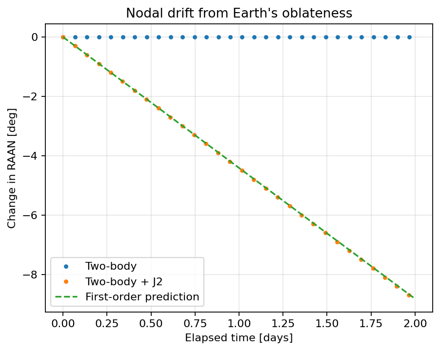

# Python-Based Spacecraft Dynamics and Control Testbed

This project is a modular Python simulation environment for spacecraft orbital motion, attitude dynamics, sensors, actuators, and control algorithms.

## Project Objectives

- Simulate two-body orbital motion around Earth
- Add perturbation models such as J2
- Propagate spacecraft attitude using quaternions
- Simulate sensors such as gyroscopes and sun sensors
- Simulate actuators such as reaction wheels and magnetorquers
- Implement attitude control laws
- Visualize orbital and attitude behavior

## Current Version

Two-body and J2 orbit propagation with a closed-loop quaternion PD attitude-control demo.

## Implemented Capabilities

- Two-body orbital dynamics and an optional J2 gravity model for an oblate central body
- Quaternion utility functions for normalization, multiplication, conjugation, error calculation, kinematics, and angle extraction
- Euler rigid-body rotational dynamics model
- Quaternion PD attitude controller with proportional attitude-error feedback, derivative body-rate feedback, and optional torque saturation
- Closed-loop attitude-control demo that saves convergence plots for attitude error, body rates, control torque, and quaternion history

## Validate the J2 orbit model

From the repository root with the project dependencies installed, run:

```bash
python -m scripts.run_j2_orbit
python -m unittest discover -s tests -v
```

The demo starts both gravity models from the same circular two-body initial
state at 650 km altitude and 51.6° inclination. It propagates for two days and
measures the right ascension of the ascending node (RAAN) at each south-to-north
equator crossing. At a crossing, the spacecraft's inertial longitude equals
RAAN. Fitting that angle against time measures the drift of the orbital plane.

| Model | RAAN rate (deg/day) |
| --- | ---: |
| Two-body baseline | 0.00000 |
| Two-body + J2 | −4.42455 |
| First-order secular prediction | −4.40675 |

The negative sign means the ascending node moves west. For the circular
reference orbit, the first-order rate is `−(3/2) n J2 (R/a)² cos(i)`,
where `n = sqrt(μ/a³)`. The 0.40% difference is consistent with using the
initial osculating elements in a first-order, orbit-averaged prediction. The
tests also check that the direction reverses for a 98° retrograde orbit.



The inertial z-axis follows Earth's fixed symmetry axis. The force model
includes point-mass gravity and the unnormalized J2 term. Position and radius
are in km, time is in seconds, and μ is in km³/s².

References: [Cartesian J2 acceleration](https://docs.poliastro.space/en/stable/autoapi/poliastro/core/perturbations/index.html)
and [first-order nodal rate](https://docs.poliastro.space/en/stable/autoapi/poliastro/twobody/orbit/scalar/index.html).

## Run the Quaternion PD Attitude-Control Demo

From the repository root:

```bash
python scripts/run_quaternion_pd_demo.py
```

The script prints final convergence metrics and saves a figure to:

```text
figures/quaternion_pd_attitude_control.png
```

The demo is documented in:

```text
docs/quaternion_pd_attitude_control.md
```

## Planned Modules

1. Orbit propagation
2. Attitude propagation
3. Environmental disturbances
4. Sensor models
5. Actuator models
6. Control algorithms
7. Visualization tools
8. Automated simulation scripts

## Repository Structure

```text
spacecraft-dynamics-control-testbed/
├── src/
│   ├── orbit/
│   ├── attitude/
│   │   ├── quaternion.py
│   │   └── rigid_body.py
│   ├── control/
│   │   └── quaternion_pd.py
│   └── sensors/
├── scripts/
│   └── run_quaternion_pd_demo.py
├── figures/
├── docs/
│   └── quaternion_pd_attitude_control.md
├── README.md
├── requirements.txt
└── .gitignore
```
